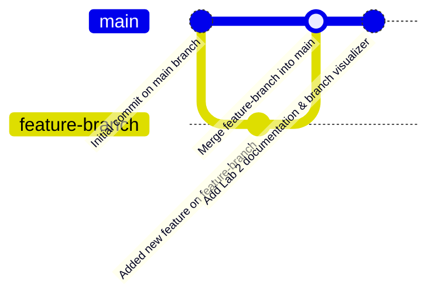

# College Lab Activity — Experiment 2
## Creating and Managing Branches in Git


---

## 📋 Experiment Overview
- **Course**: Software Engineering & Version Control Lab
- **Experiment No**: 2
- **Title**: Creating and Managing Branches
- **Student**: Shreyas M H ([@shreyasMH26](https://github.com/shreyasMH26))
- **Objective**: Set up a new workspace for Lab 2, initialize a Git repository, create a new branch named `feature-branch`, add new work, switch back to the `main` branch, and merge the feature branch into main.

---

## 🌿 Git Branching & Merging Workflow



---

## 🛠️ Step-by-Step Execution Log (Lab Manual Compliance)

### Step 1 & 2: Create directory for Lab 2 and enter it
```bash
mkdir lab2
cd lab2
```

### Step 3: Initialize Git Repository
```bash
git init
```

### Step 4: Make initial commit on `main` branch
```bash
echo "Starting point for lab 2" > initial.txt
git add .
git commit -m "Initial commit on main branch"
```

### Step 5: Create and switch to `feature-branch`
```bash
git checkout -b feature-branch
```
*The `-b` flag simultaneously creates `feature-branch` and switches HEAD to it.*

### Step 6: Make changes, stage, and commit on the feature branch
```bash
echo "Building a new feature." > new_feature.txt
git add .
git commit -m "Added new feature on feature-branch"
```

### Step 7: Switch back to the `main` branch
```bash
git checkout main
```

### Step 8: Merge the changes from `feature-branch`
```bash
git merge feature-branch
```
*Successfully incorporated changes from `feature-branch` into `main` via fast-forward merge.*

### Step 9: Connect and Push to GitHub Remote
```bash
git remote add origin https://github.com/shreyasMH26/lab2.git
git push -u origin main
git push -u origin feature-branch
```
*Both `main` and `feature-branch` are pushed to GitHub so the instructor can view both branches directly in GitHub's branch selector.*

---

## 🎨 Creative Enhancement: Branch Visualizer Script

An interactive script `feature_app.py` was developed to inspect branches and commit graphs live in the terminal:
- ASCII art banner
- Visual breakdown of the branch lifecycle
- Real-time Git branch status and log graph output

### How to run:
```bash
python3 feature_app.py
```

---

## 🔍 Verification Commands for Evaluator / Mam

### 1. View Git Log Graph:
```bash
git log --graph --oneline --all
```

### 2. Verify Available Branches:
```bash
git branch -a
```

---
*Submitted for evaluation — Lab 2 Activity Completed.*
